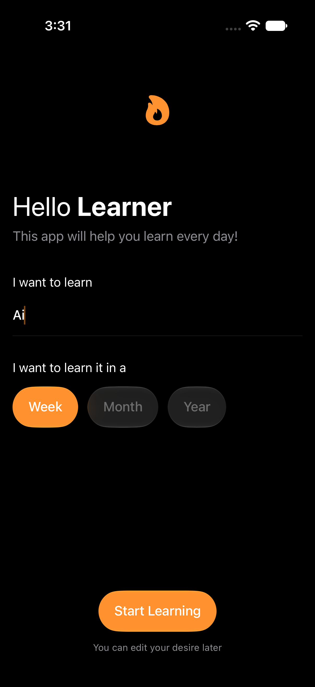
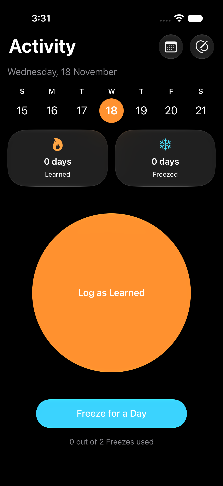
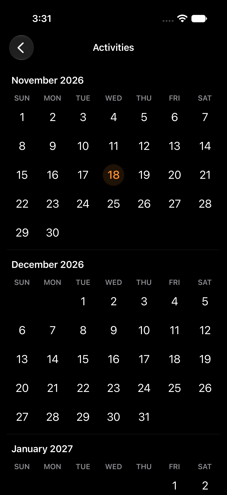

# Learning Journey

Learning Journey helps you build a daily learning habit. You pick a topic and a goal length, then log each day as **learned** or **freezed**, and the app keeps your streak alive as long as you show up.

<!-- Screenshots: put images in a Screenshots/ folder and keep these paths -->
<p align="center">
  
  
  
</p>

## Main Features

- **Set a learning goal**: choose what you want to learn and for how long (Week, Month, or Year).
- **Log your day**: tap the big button to log the day as learned, once per day.
- **Freeze a day**: skip a day without losing your streak. Freezes are limited: 2 per week, 8 per month, 96 per year.
- **Track your progress**: see the current week at a glance, plus your learned and freezed day counts.
- **Finish your goal**: when the goal ends, the app tells you whether you completed it and lets you set the next one.
- **Change your goal**: edit the topic or duration anytime from a sheet. The app asks for confirmation because your streak starts over.
- **Browse your history**: a calendar of every learned and freezed day, including past goals.
- **Built for everyone**: Light and Dark mode, Dynamic Type, and VoiceOver support.

## Business Rules

| Rule | Decision |
|------|----------|
| Streak break | More than 32 hours between logs (a freeze counts as a log). 39 hours on consecutive days still breaks the streak. |
| Freeze | Keeps the streak alive. Limit per goal: Week 2 · Month 8 · Year 96. Not refunded when the streak breaks. |
| Goal length | Week = 7 days · Month = calendar month · Year = calendar year, counted from the start day at midnight. |
| Goal result | Completed if the streak never broke until the end; otherwise not met. Shown as soon as the last day is logged. |
| Changing the goal | The streak starts over. If today was already logged, the new goal can log from tomorrow. Old history stays in the calendar. |
| One log per day | Across all goals, enforced by `#Unique` on `DayLog.day`. |

## Technologies

- **SwiftUI** with Liquid Glass buttons and toolbars
- **SwiftData** for local storage
- **MVVM** with `@Observable` view models
- **Swift Testing** for unit tests
- **String Catalog** with plural rules
- **Icon Composer** for the app icon

**Requirements:** Xcode 27 · iOS 27

## Project Structure

```
LearningJourney/
├── App/              App entry point and root navigation
├── Models/           SwiftData models (Goal, DayLog) and GoalDuration
├── Services/         StreakEngine (all business rules) and calendar math
├── Features/         Onboarding, Activity, GoalEditor, Calendar
├── Components/       Reusable views (DayCell, DurationPicker, GoalFormView)
├── Resources/        Theme colors and String Catalog
└── Preview Content/  Fixtures and sample data for previews and tests
```

All streak and goal rules live in `StreakEngine`, a pure Swift type with no UI or database code, so every rule is covered by unit tests.

## Testing

### Device Time Testing

Tested on a physical iPhone running iOS 27 by changing the device date, time, and time zone.

| # | Scenario | Expected | Result |
|---|----------|----------|--------|
| 1 | App open at midnight | Log button re-enables within a minute | ✅ |
| 2 | Return from background the next day | Log button enabled immediately | ✅ |
| 3 | 31h vs 33h without logging | 31h keeps the streak · 33h resets it, history stays | ✅ |
| 4 | Time zone change | Today's log stays on the same day | ✅ |
| 5 | Goal ends while the app is open | Goal end screen appears without relaunch | ✅ |

**scenePhase decision:** Not needed. `TimelineView(.everyMinute)` refreshed correctly when returning from the background.

### Edge-case QA

| # | Case | Expected | Result |
|---|------|----------|--------|
| 1 | Double-tap Log | One log only, Learned = 1 | ✅ |
| 2 | Freeze with 0 left | Freeze disabled, "2 out of 2", Log still enabled | ✅ |
| 3 | Update goal on a logged day | New goal 0/0, both buttons disabled today, today stays colored | ✅ |
| 4 | Very long / blank / emoji topic | No layout break · blank disables Start · emoji saved | ✅ |
| 5 | Week starts on Monday | Strip and calendar start on Monday, days aligned | ✅ |
| 6 | First launch | Onboarding, then Activity with 0/0 and today pending | ✅ |
| 7 | Force quit after logging | Log persists after relaunch | ✅ |
